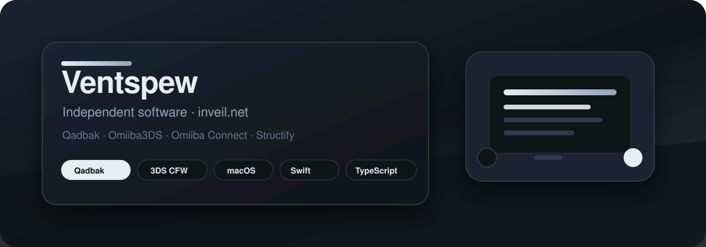
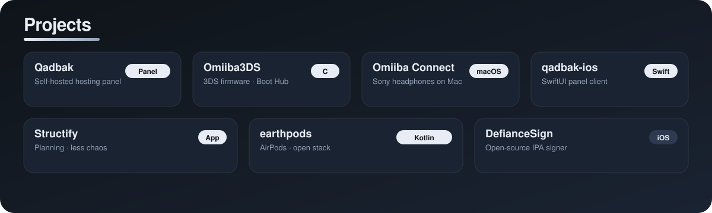

<div align="center">



[](https://github.com/Ventspew)
[](https://github.com/Ventspew?tab=followers)
[](https://inveil.net)
[](https://qadbak.com)

**Independent software — self-hosted hosting, firmware, macOS tools, and open experiments.**

[inveil.net](https://inveil.net) · [qadbak.com](https://qadbak.com) · [All repositories](https://github.com/Ventspew?tab=repositories)

</div>

## Hey, I'm Ventspew

I run **[Inveil](https://inveil.net)** and build **[Qadbak](https://github.com/Ventspew/qadbak)** — a self-hosted Linux hosting panel for your own VPS. Premium licenses ship via Stripe at [license.inveil.dev](https://license.inveil.dev).

Side projects include **[Omiiba3DS](https://github.com/Ventspew/Omiiba3DS)**, **[Omiiba Connect](https://github.com/Ventspew/OmiibaConnect)**, Structify, and smaller experiments.

Ideas, releases, and hands-on testing are mine. I sometimes use AI as a coding assistant; direction and quality calls stay human.

```text
current focus: Qadbak Premium · Inveil site · 3DS firmware polish
stack:         TypeScript · Swift · C · Kotlin
home:          https://inveil.net
```

## Project map



## Featured work

| Project | What it is | Tech |
| --- | --- | --- |
| [Qadbak](https://github.com/Ventspew/qadbak) | Self-hosted hosting panel — Ubuntu/Debian VPS, 25 apps, Jellyfin, LTS upgrades. Apache 2.0 core; Premium from €2.50/mo. | TypeScript |
| [qadbak-ios](https://github.com/Ventspew/qadbak-ios) | Native SwiftUI iOS app for the Qadbak panel. | Swift |
| [Omiiba3DS](https://github.com/Ventspew/Omiiba3DS) | Luma3DS-based CFW fork — Boot Hub, GBA/DS Labs, VC Patch Helper, wireless tools, OTA helpers. | C |
| [Omiiba Connect](https://github.com/Ventspew/OmiibaConnect) | macOS app for Sony WH-1000XM3-class headphones — battery, EQ, ambient sound, virtual sound. | C++ / ObjC |
| [Structify](https://github.com/Ventspew/Structify) | macOS app for organizing projects, features, priorities, and progress. | Swift |
| [earthpods](https://github.com/Ventspew/earthpods) | AirPods outside Apple's ecosystem. | Kotlin |
| [DefianceSign](https://github.com/Ventspew/DefianceSign) | Open-source IPA signer for iPhone and iPad. | — |

## Repository highlights

<div align="center">

[](https://github.com/Ventspew/qadbak)
[](https://github.com/Ventspew/Omiiba3DS)

[](https://github.com/Ventspew/OmiibaConnect)
[](https://github.com/Ventspew/qadbak-ios)

</div>

## GitHub activity

<div align="center">

[](https://github.com/Ventspew)


</div>

## What I'm improving next

- **Qadbak / Inveil** — Premium checkout, license server, and clearer docs for self-hosters.
- **Omiiba3DS** — easier install paths, testing, and docs for new users.
- **Omiiba Connect** — XM3 reliability and clearer device support matrix.

## Quick links

- [Qadbak — latest release](https://github.com/Ventspew/qadbak/releases/latest)
- [Buy Qadbak Premium](https://license.inveil.dev/buy)
- [Inveil — company site](https://inveil.net)
- [Omiiba3DS — latest release](https://github.com/Ventspew/Omiiba3DS/releases/latest)
- [Omiiba Connect — latest release](https://github.com/Ventspew/OmiibaConnect/releases/latest)

---

<div align="center">

### Built with care. Shipped in the open.

**Inveil** · [inveil.net](https://inveil.net)

</div>
